#+title: Vellumory

A PDF reader for GNU Emacs.  Vellumory shows PDF pages in one continuous,
sharp column in an ordinary Emacs buffer, rendered by MuPDF on worker
threads outside Emacs' main thread.  It also reads XPS, EPUB, CBZ and FB2,
has a reading mode that reflows a document to the window, validates PDF/A
and PDF/UA with veraPDF, adds a text layer with OCR, and records every edit
it makes so that any earlier state of a file can be restored byte for byte.

It is an Emacs PDF viewer in the line of DocView and pdf-tools, and an
alternative to them; it works in plain Emacs, with evil, and as a Doom
Emacs module.  It is also young: this is version 0.1.0, developed and
tested on Linux.

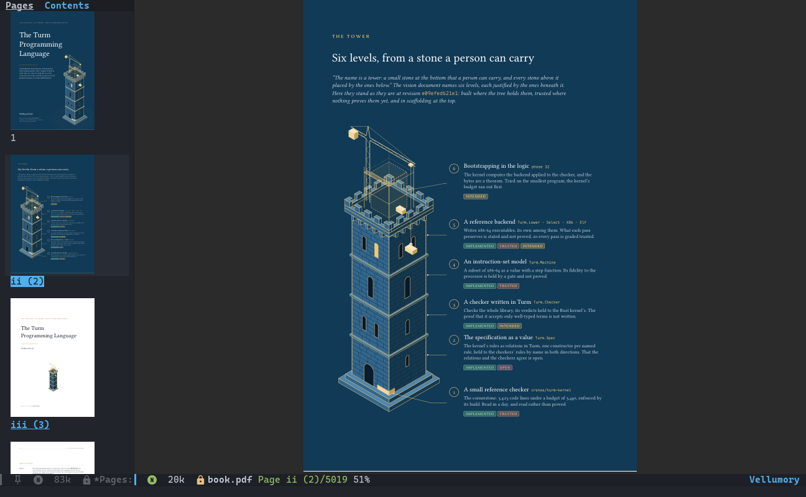

/Page 2 of the author's book "The Turm Programming Language" in Doom Emacs;
page previews on the left, page label and zoom in the mode line./

* Contents :TOC_2_gh:
- [[#description][Description]]
  - [[#what-it-is][What it is]]
  - [[#what-it-is-not][What it is not]]
  - [[#status][Status]]
- [[#features][Features]]
  - [[#reading][Reading]]
  - [[#reading-mode][Reading mode]]
  - [[#finding-your-way][Finding your way]]
  - [[#text-annotations-and-forms][Text, annotations and forms]]
  - [[#inspecting-and-validating][Inspecting and validating]]
  - [[#editing-with-a-history][Editing with a history]]
  - [[#org-latex-and-notes][Org, LaTeX and notes]]
  - [[#dired-batches-and-the-command-line][Dired batches and the command line]]
  - [[#evil-doom-and-the-mouse][Evil, Doom and the mouse]]
- [[#comparison][Comparison]]
  - [[#feature-matrix][Feature matrix]]
  - [[#doom-tools-pdf][Doom's :tools pdf module]]
  - [[#where-others-are-better][Where others are better]]
  - [[#other-and-upcoming-packages][Other and upcoming packages]]
- [[#benchmarks][Benchmarks]]
  - [[#method][Method]]
  - [[#results-in-emacs][Results in Emacs]]
  - [[#results-on-the-screen][Results on the screen]]
  - [[#what-the-numbers-do-not-show][What the numbers do not show]]
- [[#prerequisites][Prerequisites]]
- [[#installation][Installation]]
  - [[#the-worker-program][The worker program]]
  - [[#nix-flake][Nix flake]]
  - [[#doom-emacs][Doom Emacs]]
  - [[#spacemacs][Spacemacs]]
  - [[#straightel][straight.el]]
  - [[#elpaca][Elpaca]]
  - [[#package-vc-and-use-package][package-vc and use-package]]
  - [[#guix-melpa-and-prebuilt-binaries][Guix, MELPA and prebuilt binaries]]
  - [[#init-file-and-evil][Init file and evil]]
- [[#configuration][Configuration]]
  - [[#options][Options]]
  - [[#keys-at-a-glance][Keys at a glance]]
- [[#hacks][Hacks]]
- [[#troubleshooting][Troubleshooting]]
- [[#frequently-asked-questions][Frequently asked questions]]
- [[#known-limitations][Known limitations]]
- [[#recommended-packages][Recommended packages]]
- [[#contributing-and-bug-reports][Contributing and bug reports]]
  - [[#development][Development]]
- [[#credits][Credits]]
- [[#licensing][Licensing]]
- [[#contact][Contact]]
- [[#appendix][Appendix]]
  - [[#command-line][Command line]]
  - [[#files-vellumory-writes][Files Vellumory writes]]

* Description
:PROPERTIES:
:CUSTOM_ID: description
:END:

** What it is
:PROPERTIES:
:CUSTOM_ID: what-it-is
:END:
Vellumory has three parts:

- An Emacs Lisp package (=lisp/=): the reader you see, its sidebars,
  search, selection, menus, Org links, evil keys and a Doom module.
- A worker program, =vellumory=, written in Lean 4 with a small C bridge
  to MuPDF (=Vellumory/=, =native/mupdf.c=).  Emacs starts it in the
  background; one worker serves every open document, renders on several
  threads, extracts text and carries out edits with qpdf.
- The same program as a command line tool, so scripts can inspect,
  validate, compare and edit documents with the same results and the same
  history as the reader.

The name joins /vellum/, the skin medieval books were written on, and
/memory/: Vellumory remembers where you were in every document, and every
state a document has been in.

** What it is not
:PROPERTIES:
:CUSTOM_ID: what-it-is-not
:END:
- Not a page-layout editor: you cannot change the text printed on a page.
  Edits work on structure (pages, metadata, attachments, annotations, form
  values, stamps, encryption, OCR) and, for experts, the raw PDF syntax.
- Not for text terminals: pages are images, so it needs a graphical Emacs.
- Not in a package archive yet, and there are no prebuilt binaries yet:
  the worker is built from source, which Nix makes one command.
- Not yet used by a person on a Mac, and untried on Windows: CI builds it
  on Apple silicon and runs its tests there, the graphical ones in Emacs's
  Cocoa build.

The full list is under [[#known-limitations][Known limitations]].

** Status
:PROPERTIES:
:CUSTOM_ID: status
:END:
Version 0.1.0 is the first public release.  It runs in its author's Doom
Emacs on Emacs 32 (development, pgtk), and it is tested by
a native Lean suite, headless ERT suites on Emacs 31.1 and 32, a GUI suite
run on X11, on native Wayland and inside Doom, and 23 Lean theorems
(render scheduler, edit history, page geometry, argument passing,
navigation, comparison) checked to use only Lean's standard axioms.  The
proofs do not make MuPDF, qpdf or veraPDF correct, and they do not replace
the tests.  [[file:docs/requirements.org][docs/requirements.org]] records what was built and how each
part was checked.

* Features
:PROPERTIES:
:CUSTOM_ID: features
:END:
Keys below are those of plain Emacs; evil users find theirs under
[[#keys-at-a-glance][Keys at a glance]].  =?= in a document opens a menu of every command, so
you do not need to learn the keys first.

** Reading
:PROPERTIES:
:CUSTOM_ID: reading
:END:
- *Continuous scrolling*, by keys, mouse wheel and the exact pixel deltas
  of a trackpad; screen-wise scrolling glides (=vellumory-smooth-scroll=).
- *Only what windows show is rendered sharp*, at the screen's pixel
  density, on as many threads as the processor has cores less two (at
  least two, at most six).  Work that scrolls away is cancelled.  While you
  move faster than pages render, a whole-page preview fills in and
  sharpens about 0.1 s after you stop; cheap pages render sharp at once;
  idle time prepares a screen ahead and half a screen behind.
- *Zoom and fit*: =+= / =-=, =C-wheel= around the pointer, fit width (=w=),
  fit page (=P=), and =c= to fit the page's ink without its white margins
  (as pdf-tools' slicing and Sioyek's smart fit), kept as the window
  resizes.
- *Two pages side by side* (=2=): as a book opens (first page alone) or in
  pairs, still continuous.  Documents that ask for two columns open that
  way, and ones that ask for their outline open with it.
- *Page colours* (=C-c C-d= cycles original, theme colours, inverted;
  =C-u C-c C-d= chooses any, =auto= included; =M-x vellumory-night-mode=
  for one document).  The renderer recolours, so text stays crisp, and
  page previews follow.
- *Presenting* (=C-c C-p=): a full-screen frame of its own, on another
  monitor if there is one, with the page transitions a PDF defines (Wipe,
  Push, Cover, Split, Box, Blinds, Dissolve, Glitter, Fade, Fly).  About 60
  frames a second at 1278 × 958 were measured on the test machine.
- *Reading across windows*: =M-x vellumory-follow-split= chains
  side-by-side windows by pixels, so a page continues from the foot of one
  column to the head of the next.
- *Formats*: PDF, XPS, EPUB, CBZ and FB2 through MuPDF.  Like DocView,
  DVI, PostScript, DjVu and office documents are read through a cached
  conversion to PDF when dvipdfmx, ps2pdf, ddjvu or LibreOffice is
  installed.  EPUB and FB2 text size follows =C-x C-+= and =C-x C--=.
- *Virtual documents*: pdf-tools' =.vpdf= files (pages and page regions of
  other documents, in your order) open unchanged and behave like one PDF.
- *Your place is kept*: page, position on it and zoom, per file and per
  content, so a renamed copy opens where you were.  Bookmarks store exact
  places.  A file rewritten by LaTeX reloads by itself.
- *Nothing is read into the buffer and nothing is written*: the worker
  reads the file, so a document of hundreds of megabytes opens without
  Emacs holding it, and =C-x C-s= never touches it.

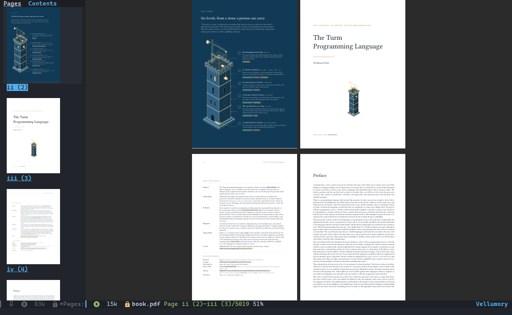

/Two pages side by side, as a book opens./

** Reading mode
:PROPERTIES:
:CUSTOM_ID: reading-mode
:END:
=C-c C-r= (=zr= with evil) shows the document as text reflowed to the
window, one column at a comfortable measure, as a phone's reading mode
does.  It is a view: the file is not changed, and =q= returns to the pages
at the place you reached.

- The worker builds each page's text from the PDF's structure tree when
  the document is tagged, and from its layout when it is not; headings,
  paragraphs, lists, code, notes and links keep their kind.
- Figures, formulas and drawings are shown as pictures of the page, sized
  so their lettering matches the text (=I= shows their text instead).
- Running heads and page numbers are left out (=H= shows them).
- Text size =+= / =-= / =0=; line length =}= / ={= (=vellumory-reflow-measure=,
  70 characters by default); colours =C= cycles =auto=, =theme=, =paper=,
  =sepia= and =night= (=vellumory-reflow-colours=); =?= has every setting.
- With =vellumory-reflow-narrow-width= set, a window too narrow for the
  pages switches to reading mode by itself, and back once it is wide
  enough.

How well a page reflows depends on the document: a tagged PDF carries its
own structure and reading order; an untagged one is only as good as the
reading order MuPDF finds in its layout.

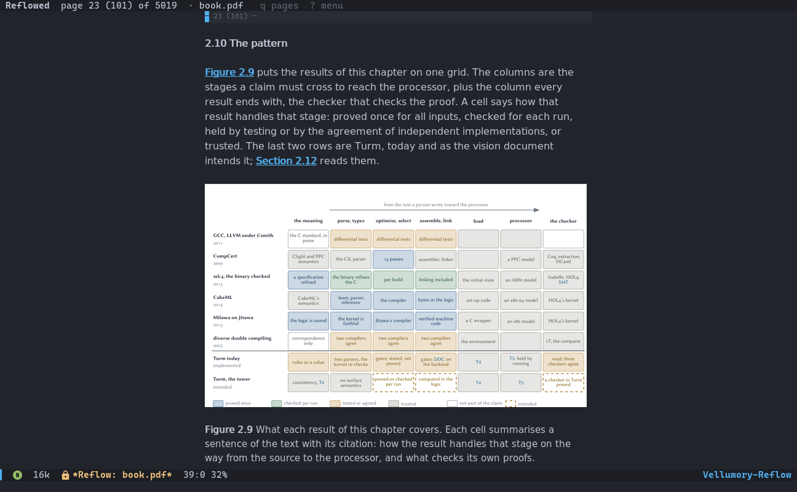

/A page of the book in reading mode: its heading, links and text, the
figure as a picture and its caption below, in the Emacs theme's colours./

** Finding your way
:PROPERTIES:
:CUSTOM_ID: finding-your-way
:END:
- *Search* (=/= or =C-s=): incremental, case folding, Unicode, matches
  across lines, every match highlighted on the page by the renderer;
  =C-s= / =C-r= step while typing, =M-r= switches to an Emacs regexp,
  =M-n= / =M-p= afterwards.  =C-M-s= searches a regexp directly.
- *Occur* (=M-s o=): every matching line by page label, with context;
  =C-u M-s o= searches every open document, =; o= in Dired the marked
  files.  On the 756 pages of ISO 32000, extracting the text took 1.6 s
  once per version of the file.
- *Every line of text* (=M-s l=): with consult, pages follow your choice
  as you move through the candidates; =consult-line= and Doom's
  =SPC s s= are remapped to it in documents.
- *Contents sidebar* (=o=), page previews (=T=), =s= to switch between
  them; headings with completion (=i=); Imenu; page labels everywhere,
  such as =iv (4)= (=L= goes to one).
- *Links*: hover for the target, click to follow, =f= labels every visible
  link with a short code.  *Link preview*: resting the mouse on a link
  within the document opens a small frame showing where it leads, at your
  zoom and colours, as GNOME's Papers does; the wheel scrolls it and a
  click goes there (=vellumory-link-preview= turns it off).
- *Back and forward* (=B= / =N=) after following a link, an Org link, a
  register, a SyncTeX search or an entry of the annotation list.

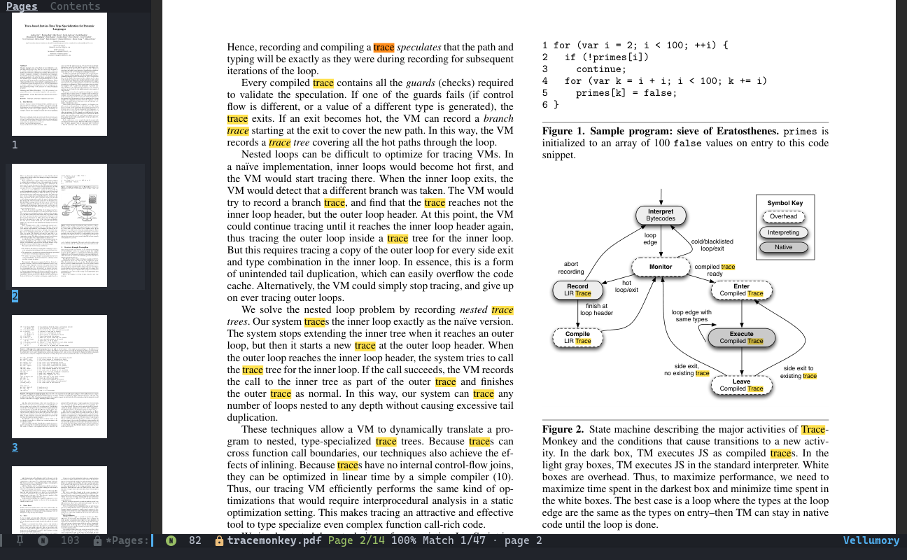

/Every match of "trace" highlighted, the current one in orange; the mode
line counts them./

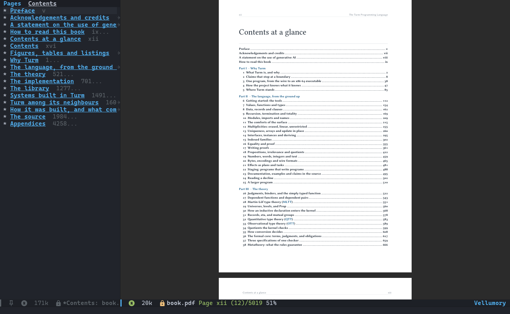

/The contents sidebar, with the page label of each heading./

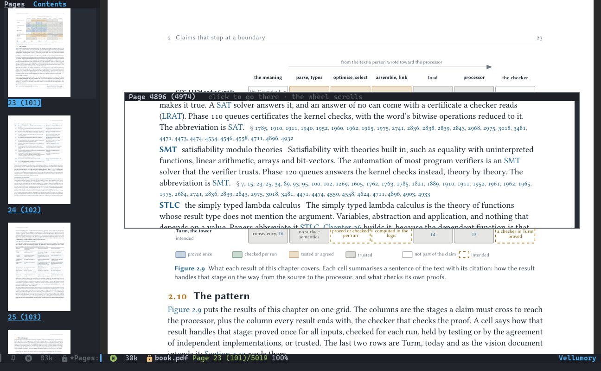

/Resting the mouse on "SMT" in a figure: its entry in the glossary, 4,800
pages on, previewed over the page./

** Text, annotations and forms
:PROPERTIES:
:CUSTOM_ID: text-annotations-and-forms
:END:
- *Selection*: drag across pages, double-click a word, triple-click a
  line; =M-w= copies, and the primary selection is set.
- *Keyboard caret* (=v=), as caret browsing in Evince and Firefox: move by
  character, line, word and block across pages, select characters or whole
  lines, copy with =y=.
- *Annotations* on selected text: highlight (=a h=), underline (=a u=),
  strike out (=a s=), squiggly underline (=a q=); notes at a click
  (=a n=); a list where you edit their text or delete them (=a l=).
  Without a comment, the marked text becomes the annotation's contents, so
  it reads well to screen readers.  PDF/A-1 documents are offered an
  underline instead of a highlight, which would need transparency.
- *Forms* (=e f=, or a click on a field): text fields, checkboxes and
  choices; the document's JavaScript never runs.

** Inspecting and validating
:PROPERTIES:
:CUSTOM_ID: inspecting-and-validating
:END:
- *Document details* (=I=): format, version, objects, revisions,
  encryption and permissions, claimed standards (PDF/A, PDF/UA, PDF/X from
  XMP), tagging and language, metadata, fonts with embedding and Unicode
  maps, images, annotations, forms (XFA too), JavaScript (never executed),
  output intents, attachments (=RET= opens one), and the page boxes of the
  page in view in points and millimetres.
- *Signatures*: each digital signature is verified with OpenSSL: intact
  bytes, signer, trust chain (and why not), and whether the document
  changed after signing.  Vellumory verifies signatures but cannot sign.
- *Validation* (=V=) with veraPDF: PDF/A-1a to 4f, PDF/UA-1 and -2, WTPDF,
  or whatever the document claims.  Failed rules by clause, repeated checks
  counted, =RET= on a check goes to its page.  PDF/UA has requirements
  only a person can judge, and the report says so.
- *Checks beyond veraPDF* (=b= in the report): links and contents entries
  that lead nowhere (MuPDF would silently send them to page 1), earlier
  versions recoverable from incremental updates, RC4 or 40-bit encryption,
  unembedded fonts, fonts without Unicode maps, boxes beyond the page, a
  damaged cross-reference table, missing title, language or tagging; each
  with the key that fixes it where Vellumory can.
- *PDF syntax* (=C-c C-c=): the document as qpdf's QDF, with highlighting,
  Imenu over objects and =M-.= on =12 0 R= references.  It can be edited
  and committed as a recorded edit.

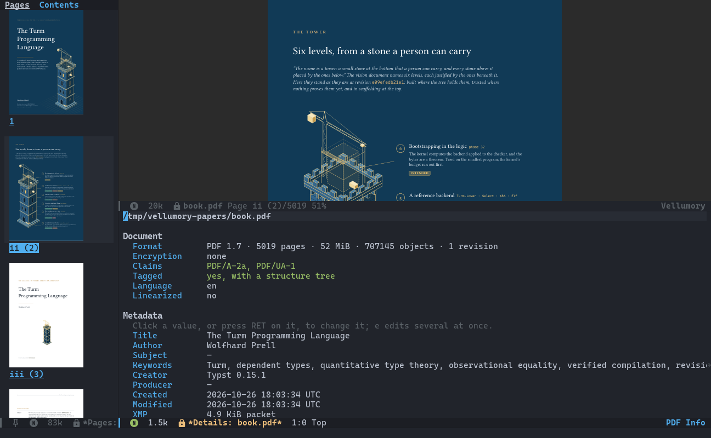

/Document details: the claims (PDF/A-2a, PDF/UA-1), tagging and metadata./

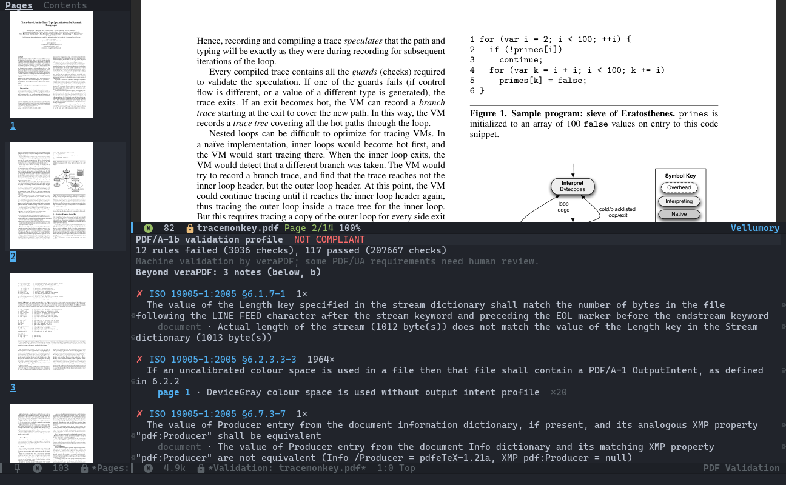

/A veraPDF report: rules by clause, a check failing 1964 times is one line./

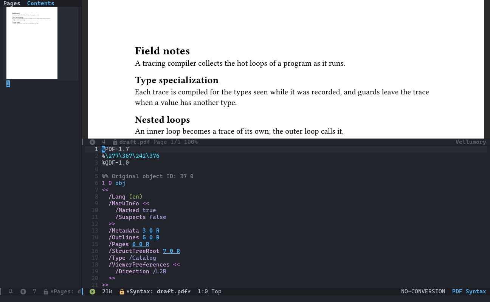

/The PDF syntax view; references are links./

** Editing with a history
:PROPERTIES:
:CUSTOM_ID: editing-with-a-history
:END:
All edits are under =e=: rotate (=e r=, =e R=), delete (=e d=), move
(=e m=), keep or reorder pages (=e k=, e.g. =3,1-2=), append documents
(=e a=), page labels (=e l=), metadata (=e i=), attachments (=e A=, =e D=),
stamps and watermarks (=e w=), OCR with ocrmypdf (=e o=), lossless
compression (=e c=), linearization (=e L=), AES-256 encryption (=e E=) and
its removal (=e P=).

Every edit goes the same way:

1. it works on an unchangeable snapshot, filed under the SHA-256 of its
   bytes in a store under =$XDG_DATA_HOME/vellumory=;
2. the result must open and have pages;
3. it is recorded in the document's history;
4. only then is your file replaced, atomically, keeping its permissions.

Undo (=C-/=) and redo (=C-?=) restore stored snapshots byte for byte, also
in a later session.  Undo and then edit differently, and the history
branches: =e h= shows the tree, where =c= makes any state current, =v=
opens it read-only and =d= compares it with the file.  A file changed by
another program is recorded first.  Edits keep PDF/A documents PDF/A (the
test suite checks this with veraPDF for PDF/A-1b and -2b), metadata edits
keep the Info dictionary, the catalog and XMP consistent, and passwords
never appear on a command line or in the history.

Extracting pages (=e x=), splitting (=e s=), exporting text (=e t=) and
exporting pages you mark in the previews or from the right-click menu
write new files and leave the document alone.  A read-only document can
still be copied for editing with =C-x C-w= (=vellumory-write-copy=).

*Comparing versions* (=d=): pages are paired by their text, so an inserted
page does not make every later page differ; added words are highlighted
in the reader, removed words listed, turned pages and changed boxes
reported, and metadata, attachments and structure compared field by field.

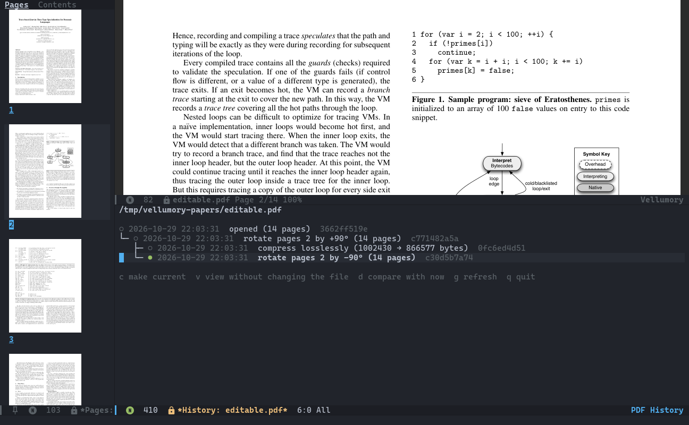

/The edit history: an undo followed by a different edit made a branch./

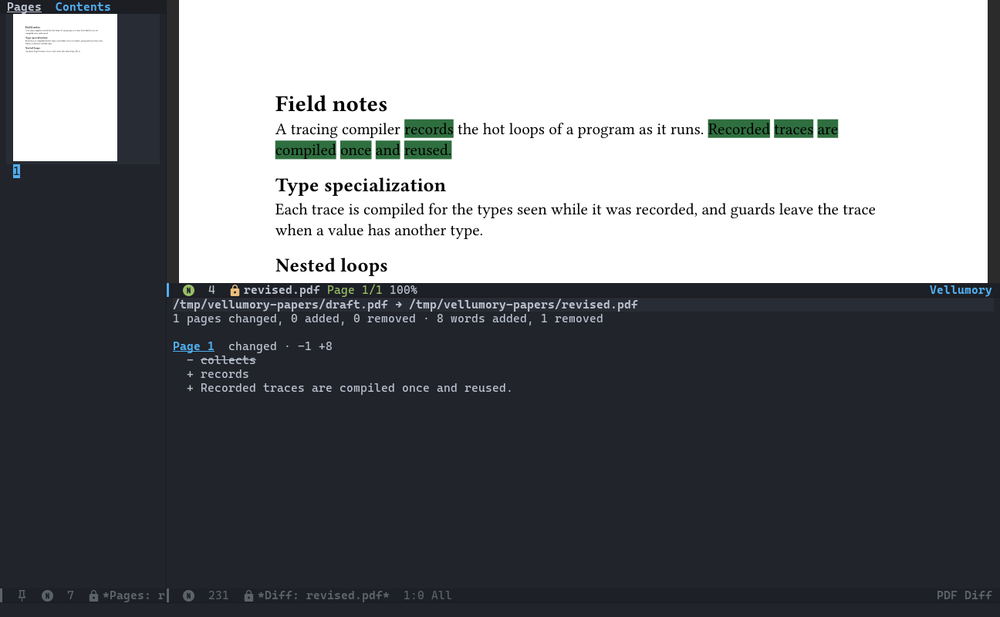

/Comparing two versions: added words highlighted on the page, the removed
one listed./

** Org, LaTeX and notes
:PROPERTIES:
:CUSTOM_ID: org-latex-and-notes
:END:
- *Org links*: =org-store-link= in a document stores the exact place,
  e.g. =vellumory:~/papers/paper.pdf::7::312.5=, described by the
  selection or the nearest heading.  Export turns them into ~FILE#page=7~
  links for HTML and LaTeX.  org-pdftools' =pdf:= links open in Vellumory
  when nothing else defines them.
- *org-noter*: sessions run on Vellumory documents; notes follow the page,
  precise notes start at the selection or a click on any visible page, and
  =org-noter-create-skeleton= turns the outline into headings.
- *SyncTeX* with TeX Live's libsynctex: with AUCTeX, Vellumory becomes the
  PDF viewer when a TeX buffer starts (also after Doom's =:lang latex=);
  =C-c C-v= in the source shows the line highlighted on its page, and
  =C-mouse-1= on a page visits its source line.
- *Org export to accessible, archival PDF*: =C-c C-e l v= writes PDF 2.0
  that is PDF/UA-2 (tagged, MathML for formulas) and PDF/A-4f through
  LuaLaTeX, validates it against both with veraPDF and opens it.
  =C-c C-e y v= does the same through Typst (PDF/A-3a and PDF/UA-1, no TeX
  needed).  Both embed the Org source in the PDF as its associated source
  file, where the standard allows it.

** Dired batches and the command line
:PROPERTIES:
:CUSTOM_ID: dired-batches-and-the-command-line
:END:
On marked files in Dired, =;= followed by =v= validates them in one
veraPDF run, =e= applies one recorded edit to each (compress, linearize,
OCR, set language or author, ...), =i= tabulates pages, standards, tagging
and size, =m= merges them, =o= lists matching lines and =V= starts a
virtual document of them.

The worker is also a command line tool; see [[#command-line][Command line]].

** Evil, Doom and the mouse
:PROPERTIES:
:CUSTOM_ID: evil-doom-and-the-mouse
:END:
- *evil*: normal-state keys modelled on evil-collection's for pdf-tools
  (=j= =k=, =gg= =G= with counts, =zi= =zo=, =/= =n= =N=, =C-o= =C-i=, =m=
  and ='= registers, =u= =C-r= undo and redo, ...).
- *Doom Emacs*: a =:tools vellumory= module with lazy loading, localleader
  keys with which-key descriptions, a doom-modeline segment, popup rules,
  =ESC= clearing search and selection, and =doom doctor= checks.
- *Menus*: =?= (=g?= with evil) is a transient menu of every command; the
  menu bar has a Document menu; a right click anywhere offers what applies
  there: on a link, a selection, a page, a page preview, a heading of the
  contents, and the lines of the history, validation and other views.
  With =context-menu-mode=, these become its menu.
- *Self-check*: =M-x vellumory-doctor= checks Emacs, the worker, file
  associations, the helper programs, evil, Doom and the directories, and
  offers buttons for what Emacs can fix itself.
- *consult, embark, project.el*: see [[#recommended-packages][Recommended packages]].

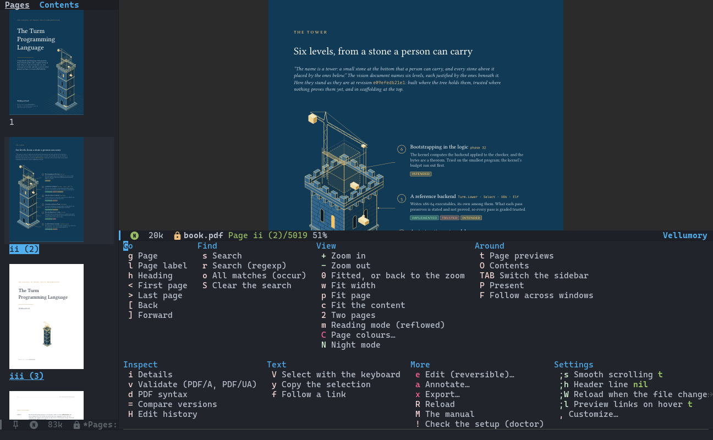

/The menu of every command, on =?=./

* Comparison
:PROPERTIES:
:CUSTOM_ID: comparison
:END:

** Feature matrix
:PROPERTIES:
:CUSTOM_ID: feature-matrix
:END:
Reading features, where the packages overlap.  Each cell comes from the
package's own documentation or source at the version named, or from
[[file:docs/research.org][docs/research.org]]; "no" means it was looked for there and not found,
"?" that it was not checked.  The others move on, so check their current
documentation too.

Versions checked: DocView of Emacs 31.1; pdf-tools 20260102.1101;
emacs-reader at revision 4fca3aa (Codeberg); EAF PDF viewer
of 2025-07-26 (nixpkgs); Vellumory 0.1.0.

|                        | Vellumory                                          | DocView                                    | pdf-tools                                     | emacs-reader                              | EAF PDF viewer                   |
|------------------------+----------------------------------------------------+--------------------------------------------+-----------------------------------------------+-------------------------------------------+----------------------------------|
| Needs besides Emacs    | its worker (Lean, MuPDF), built from source        | a converter (Ghostscript or MuPDF)         | epdfinfo (poppler), compiled on install       | a dynamic module (MuPDF), built with make | Python, Qt and PyMuPDF           |
| Pages drawn by         | Emacs                                              | Emacs                                      | Emacs                                         | Emacs                                     | Qt, over the Emacs frame         |
| Rendering              | worker threads, visible tiles only                 | every page to an image file up front       | epdfinfo, one page per request                | 8 threads in the module                   | PyMuPDF                          |
| Continuous pages       | yes                                                | page edge advances (=doc-view-continuous=) | roll mode (=pdf-view-roll-minor-mode=)        | one page, continuing to the next          | ?                                |
| Two pages side by side | yes                                                | no                                         | no                                            | no                                        | ?                                |
| Formats                | PDF XPS EPUB CBZ FB2; DVI PS DjVu office converted | PDF PS DVI DjVu ODF EPUB CBZ FB2 XPS       | PDF                                           | PDF EPUB MOBI FB2 XPS CBZ, office         | PDF XPS CBZ EPUB FB2, office     |
| Search                 | incremental, regexp, highlighted; occur            | regexp, by page, no highlights             | isearch (regexp too), highlighted; occur      | no                                        | yes                              |
| Select and copy        | mouse, keyboard caret                              | text view (=C-c C-t=)                      | mouse                                         | no                                        | yes                              |
| Links                  | follow, hints, hover preview                       | no                                         | follow, hints                                 | no                                        | follow                           |
| Outline                | sidebar, Imenu                                     | Imenu                                      | outline buffer, Imenu                         | outline buffer, Imenu                     | yes                              |
| Dark pages             | theme colours, inverted, night mode                | SVG face colours                           | midnight, themed                              | dark mode                                 | inverted                         |
| Annotations            | 4 markup kinds, notes; edit text, delete           | no                                         | text and markup; edit, recolour, move, delete | no                                        | 4 markup kinds, text; edit, move |
| Presentation           | full screen, page transitions                      | no                                         | no                                            | yes                                       | yes                              |
| SyncTeX                | yes                                                | no                                         | yes                                           | no                                        | yes                              |
| org-noter              | yes                                                | yes                                        | yes                                           | no                                        | no                               |
| evil keys              | built in                                           | evil-collection                            | evil-collection                               | evil-collection                           | its own single keys              |
| Platforms              | Linux (tested)                                     | any Emacs with PNG and a converter         | Linux; macOS and Windows "as is"              | Linux, macOS, Windows                     | ?                                |

Vellumory also inspects, validates and edits documents (see [[#features][Features]]);
the matrix leaves those out.

** Doom's :tools pdf module
:PROPERTIES:
:CUSTOM_ID: doom-tools-pdf
:END:
Doom's default for PDFs is its =:tools pdf= module: pdf-tools, with what the
module adds around it.  Each of those additions, from the module's
=config.el= and =packages.el= (Doom at the commit this repository's flake
pins), and what =:tools vellumory= does instead:

| =:tools pdf= (pdf-tools)                                  | =:tools vellumory=                                                               |
|-----------------------------------------------------------+----------------------------------------------------------------------------------|
| PDFs open by name and by content                          | the same (=vellumory-install=), and EPUB, XPS, CBZ, FB2, DjVu, PS, DVI           |
| Without =epdfinfo=: plain text, and a message to build it | without the worker: a message naming it and =M-x vellumory-doctor=               |
| =epdfinfo= compiles in Emacs (=M-x pdf-tools-install=)    | the worker comes built from Nix, or =lake build=; nothing compiles in Emacs      |
| One page at a time, fit to the page by default            | continuous pages, fit to the width by default (=P= fits the page)                |
| HiDPI by scaling                                          | rendered at the display's resolution                                             |
| Popup rules for the outline and annotation buffers        | contents and previews in a side window that follows its document                 |
| =q= kills the buffer                                      | =q= quits                                                                        |
| Midnight colours refreshed when the theme changes         | page colours that follow the theme, inversion, and night mode per document       |
| No "file is large" question for PDFs                      | none for any document Vellumory opens                                            |
| Reading position by saveplace-pdf-view (page and zoom)    | the exact position (page, offset, zoom), by file and by content                  |
| =pdf:= Org links by org-pdftools                          | =vellumory:= links with exact positions; =pdf:= links open too without pdf-tools |
| evil keys from evil-collection                            | its own evil keys, =SPC m= and the =?= menu                                      |

What pdf-tools still does that Vellumory does not is in the next section.

** Where others are better
:PROPERTIES:
:CUSTOM_ID: where-others-are-better
:END:
- *DocView* comes with Emacs: nothing to build, and it runs wherever Emacs
  has PNG support and a converter.  On the screen benchmark its median
  scroll step was level with Vellumory's (3.2–4.1 ms against 3.7–4.3 ms).
- *pdf-tools* has been developed since 2013, is on MELPA, and its
  documentation says it works on macOS and Windows.  Its annotations can be
  recoloured and moved; Vellumory's can only have their text edited.
  org-pdftools was written for it, and org-noter supports it.  On
  a short document its roll mode opened as fast as Vellumory (71–86 ms
  against 77–90 ms).
- *emacs-reader* is one dynamic module, no separate process; it opens
  MOBI, and office documents through MuPDF without LibreOffice; it builds
  on macOS and Windows, has a Guix channel, and its README says it is to
  be published on GNU ELPA.
- *EAF's PDF viewer* draws in Qt, outside Emacs' display engine.  Where the
  pgtk build of Emacs ran on X11 and added about 8 ms to every Emacs
  viewer's step, EAF's median step (9.0–10.0 ms) was lower than
  Vellumory's (11.8–13.7 ms).  Its annotations include inline text and can
  be moved.
- *doc-tools* renders every page when a file opens, so its scrolling is
  smooth too: worst step 7.0–9.5 ms against Vellumory's 6.1–6.6 ms.
- *Vellumory* needs a worker you build yourself today, has been tested only
  on Linux, has no print command, and is at its first release.

** Other and upcoming packages
:PROPERTIES:
:CUSTOM_ID: other-and-upcoming-packages
:END:
From [[file:docs/research.org][docs/research.org]], which records where each claim comes from:

- [[https://github.com/vedang/pdf-tools][pdf-tools]]: poppler through the epdfinfo server; roll mode renders whole
  pages synchronously while Emacs redisplays.  The reference for features
  and file formats; Vellumory reads its =.vpdf= files and keeps evil keys
  close to evil-collection's for it.
- [[https://codeberg.org/MonadicSheep/emacs-reader][emacs-reader]] (the Emacs Reader, presented at EmacsConf 2025): MuPDF in a
  dynamic module with cloned contexts on 8 threads, whole pages as PPM.
  The closest in design; Vellumory differs in rendering only the visible
  parts of pages, in a separate process.
- DocView (built in): converts every page with external programs first.
- [[https://github.com/emacs-eaf/eaf-pdf-viewer][EAF PDF viewer]]: PyMuPDF in a Qt window over the Emacs frame.
- [[https://github.com/dalanicolai/doc-tools][doc-tools]] with [[https://github.com/dalanicolai/image-roll.el][image-roll]] (dalanicolai): =mutool draw= renders every
  page to PNG on opening; its README calls it a work in development.
- pdf-tools with the vimura server (dalanicolai's fork and
  [[https://pypi.org/project/vimura-server/][vimura-server]]): PyMuPDF answering epdfinfo's requests; its precursor
  calls itself a proof of concept.
- [[https://github.com/emacs-taf/etaf-reader][etaf-reader]] (created 2026-10-12): a text ebook reader; a PDF becomes
  =pdftotext= text, so no page is drawn.
- Not working as viewers when checked: [[https://github.com/zbelial/epdf][epdf]] (a module-test skeleton),
  [[https://github.com/condy0919/pdf-mode][yapdf]] (never opens its file); appine embeds macOS's PDFKit, so it
  does not run on Linux.

* Benchmarks
:PROPERTIES:
:CUSTOM_ID: benchmarks
:END:
Speed claims are worth little without their method, so here are both.
Every figure, run by run, is in [[file:docs/reader-validation.org][docs/reader-validation.org]].

** Method
:PROPERTIES:
:CUSTOM_ID: method
:END:
- One machine: an AMD Ryzen 5 3600 (12 threads) server, Emacs on a
  private Xvfb display.  Each run in a freshly started Emacs with
  byte-compiled code; figures are ranges over consecutive runs.
- *In Emacs* (=tests/bench.el=): each reader follows the same script on
  the same document and window.  /Blocking/ is the main thread's time for
  a command plus a forced redisplay, the delay a keypress feels; /sharp/
  is the time until every visible part shows its final rendering.
- *On the screen* (=tests/screen-bench.el=): ffmpeg records 640 × 480 of
  the page area at 200 frames a second while each viewer reads the same
  script (open, jump to pages 5, 12 and 3, thirty 96-pixel steps).  An
  action has /settled/ at the last changed frame before the next one.  This
  includes EAF, which draws outside Emacs.
- Run from the development shell:
  =lean --run scripts/Build.lean lake env lean --run scripts/Review.lean bench FILE=
  and =... Review.lean screenbench FILE EMACS=.

** Results in Emacs
:PROPERTIES:
:CUSTOM_ID: results-in-emacs
:END:
ISO 32000-1:2008 (756 pages, 22 MB), Emacs 32.0.50 pgtk, measured
2026-10-28.  pdf-tools and emacs-reader at fit width, DocView with
=doc-view-continuous=.

| Measure                     | Vellumory   | emacs-reader | pdf-tools roll | pdf-tools   | DocView      |
|-----------------------------+-------------+--------------+----------------+-------------+--------------|
| Open, until sharp           | 136–166 ms  | 160–178 ms   | 171–183 ms     | 504–605 ms  | 1145–1163 ms |
| Jump to page 300, blocking  | 0.8–4.2 ms  | 68–72 ms     | 49–61 ms       | 63–92 ms    | 7.7–8.9 ms   |
| Jump to page 300, sharp     | 12–80 ms    | as blocking  | as blocking    | as blocking | 211–213 ms   |
| Reading scroll, mean step   | 1.1–1.6 ms  | 7.8–9.3 ms   | 5.4–7.5 ms     | 7.6–11.5 ms | not measured |
| Reading scroll, median step | 0.5–0.8 ms  | 1.9–2.3 ms   | 1.2–2.5 ms     | 0.9–1.4 ms  | not measured |
| Reading scroll, 95th pct.   | 5.7–9.0 ms  | 52–55 ms     | 43–51 ms       | 52–89 ms    | not measured |
| Reading scroll, worst step  | 9.8–12.9 ms | 53–61 ms     | 48–63 ms       | 62–94 ms    | not measured |

Opening is level with emacs-reader (the ranges overlap) while laying out
all 756 pages; a jump blocks input for under 5 ms; the worst reading step
is below the others' 95th percentile.  On the 14-page tracemonkey paper,
pdf-tools' roll mode opened as fast (71–86 ms against 77–90 ms).

** Results on the screen
:PROPERTIES:
:CUSTOM_ID: results-on-the-screen
:END:
tracemonkey.pdf (14 pages), all viewers in the same Emacs 31.1 built for
X, measured 2026-10-29, two runs (pdf-tools with vimura: three).

| Viewer            | Open, settled | Jump, settled | Step, median | Step, worst |
|-------------------+---------------+---------------+--------------+-------------|
| Vellumory         | 64–72 ms      | 30–36 ms      | 3.7–4.3 ms   | 6.1–6.6 ms  |
| emacs-reader      | 186–223 ms    | 64–66 ms      | 4.0–4.2 ms   | 39–42 ms    |
| pdf-tools         | 547–583 ms    | 144 ms        | 5.5–5.6 ms   | 145–150 ms  |
| pdf-tools roll    | 489–510 ms    | 133–153 ms    | 5.7–6.2 ms   | 142–159 ms  |
| pdf-tools, vimura | 887–986 ms    | 392–477 ms    | 4.4–4.6 ms   | 442–539 ms  |
| DocView           | 466–496 ms    | 205–207 ms    | 3.2–4.1 ms   | 709–753 ms  |
| doc-tools         | 1155–1172 ms  | 363–381 ms    | 4.0–4.3 ms   | 7.0–9.5 ms  |
| EAF               | 676–759 ms    | 81–93 ms      | 9.3–9.6 ms   | 50–58 ms    |

Median steps inside Emacs are level: their differences are below the 5 ms
between two recorded frames.  Where Vellumory differs is opening, jumping
and the worst steps, the stutters you notice.

The same paper against desktop readers, measured 2026-10-30 with the same
input for all (five runs; Vellumory in the X11 Emacs 31.1):

| Viewer    | Open, settled | Jump, settled | Down, first change | CPU, 60 steps |
|-----------+---------------+---------------+--------------------+---------------|
| Vellumory | 131–166 ms    | 20–25 ms      | 3.1–4.9 ms         | 160–330 ms    |
| Evince    | 348–413 ms    | 21–41 ms      | 3.9–5.0 ms         | 180–210 ms    |
| Papers    | 395–455 ms    | 35–54 ms      | 35–42 ms           | 4300–5160 ms  |
| Okular    | 327–375 ms    | 53–57 ms      | 20–21 ms           | 820–1030 ms   |

Steps and jumps are level with Evince.  Papers and Okular animate a step
(for 200 and 100 ms) by design, and Papers drew on the CPU, as the server
has no GPU.

Memory is what all of a viewer's processes hold after the steps (their
resident sets); for Vellumory that includes Emacs itself, 73 MiB before it
opens anything.  In those runs Vellumory held the most, 211–218 MiB, plus
38 MiB of strips in a temporary file system.  Three causes were found and
changed.  Emacs kept the pixels of strips scrolled away; it now frees them
once reading rests.  The C library kept freed memory instead of giving it
back, in Emacs and in the worker; both now give it back at rest (after 40
pages of ISO 32000, Emacs held 528 MiB before, 158 MiB after).  And each
strip passed through a second buffer in the worker; the renderer now writes
it to its file directly.  The temporary strips are also capped at 128 MiB
(512 before).  Measured again on 2026-10-30, three runs, with a second
sample three seconds after the last step:

| Viewer    | After the steps | Three seconds later |
|-----------+-----------------+---------------------|
| Vellumory | 163–176 MiB     | 156–169 MiB         |
| Evince    | 142–144 MiB     | 142–144 MiB         |
| Papers    | 165–166 MiB     | 165–166 MiB         |
| Okular    | 191–197 MiB     | 138–197 MiB         |

Vellumory now holds about what Papers does and less than Okular, and still
15–25 MiB more than Evince.  The method and the reasons, from each reader's
source, are in [[file:docs/reader-validation.org][docs/reader-validation.org]].

** What the numbers do not show
:PROPERTIES:
:CUSTOM_ID: what-the-numbers-do-not-show
:END:
- They come from one server on a virtual display; no laptop or physical
  screen was measured, and HiDPI was checked only at GTK scale 2 on a
  virtual display.
- On the pgtk build of Emacs 32 forced onto X11, every Emacs viewer's
  step grew by about 8 ms (Vellumory: median 11.8–13.7 ms, worst
  19.9 ms); the order held, but EAF, outside Emacs, then had the lowest
  median.  No screen recording was made under Wayland.
- Other documents, with heavier pages, behave differently.  Very long ones
  pay for their length when the layout is made again, on opening, zooming
  or a change of the window's width: on a 5,019-page book (54 MB), byte
  compiled, 120 ms each time, after a fix of 2026-10-30 (it was 750 ms,
  walking lists once per page).  Moving through that book (next page,
  scrolling, jumping, splitting a window) takes about 1 ms.  Opening it
  takes 0.8 s the first time and 0.5 s after: its pages' sizes are kept by
  content address, as measuring them took the worker 280 ms.
- Interpreted Lisp roughly doubles layout and redisplay work; the numbers
  hold for byte-compiled code only.

* Prerequisites
:PROPERTIES:
:CUSTOM_ID: prerequisites
:END:
- GNU Emacs 29.1 or newer, on a graphical display (X, Wayland or pgtk)
  with image support.  The graphical tests run on Emacs 31.1 and the
  development version 32; the Emacs test suite also passes in batch mode on
  29.4 and 30.2, and CI is set up for 29.4, 30.2, 31.1 and the snapshot.
  Exporting Org to accessible PDF needs Org 9.7 (Emacs 30's, or from GNU
  ELPA).
- Linux.  The Nix flake builds for =x86_64-linux= and =aarch64-linux=;
  tests and measurements were made on x86_64.
- The worker program (next section).  Today it is built from source.

Optional programs, each enabling only what its row says:

| Program                            | Enables                                                 |
|------------------------------------+---------------------------------------------------------|
| qpdf (with fix-qdf)                | every edit, extracting, splitting, merging, syntax view |
| veraPDF                            | validation, batch validation, checks after Org export   |
| ocrmypdf with Tesseract            | OCR                                                     |
| LuaLaTeX of TeX Live 2025 or newer | Org export through LaTeX                                |
| Typst 0.14 or newer and ox-typst   | Org export through Typst                                |
| dvipdfmx, ps2pdf, ddjvu, soffice   | reading DVI, PostScript, DjVu, office files             |

The Nix build compiles the exact paths of qpdf, fix-qdf, veraPDF and
ocrmypdf into the worker; other builds look for them on =PATH=.
=M-x vellumory-doctor= tells you which ones it finds.

* Installation
:PROPERTIES:
:CUSTOM_ID: installation
:END:
Two parts are installed: the Emacs Lisp package and the worker it talks
to.  The Nix flake builds both and is the tested way.  The other recipes
below install the Lisp from GitHub; you then build the worker and point
=vellumory-program= at it.  Keep the Lisp and the worker at the same
revision: =M-x vellumory-doctor= says when their protocol versions differ.

Recipes marked /untested/ follow each package manager's documented format
but have not been run by the author.  Reports are welcome.

** The worker program
:PROPERTIES:
:CUSTOM_ID: the-worker-program
:END:
*With Nix* (flakes enabled), in a clone:

#+begin_src sh
git clone https://github.com/cypl0x/vellumory ~/src/vellumory
cd ~/src/vellumory
nix build path:.
#+end_src

The build also runs the test suites, so the first one takes a while.
=result/bin/vellumory= is the worker; =result/share/emacs/site-lisp/vellumory=
holds the Lisp, its generated autoloads and the Info manual.  The Lisp
finds a worker installed beside it by itself; with Lisp from anywhere
else, set:

#+begin_src emacs-lisp
(setq vellumory-program (expand-file-name "~/src/vellumory/result/bin/vellumory"))
#+end_src

*In the development shell*, for working on Vellumory:

#+begin_src sh
nix develop path:.
lean --run scripts/Build.lean prepare
lean --run scripts/Build.lean lake build vellumory
#+end_src

The worker is then =.lake/build/bin/vellumory=, which the Lisp in =lisp/=
of the same checkout finds by itself.

*Without Nix* (possible in principle, untested): Lean 4.30.0 with Lake,
the [[https://github.com/leanprover/lean4-cli][lean4-cli]] library (=lean --run scripts/Build.lean prepare PATH= vendors
it), MuPDF 1.27.2 (the worker links =libmupdf.so.27.2=), OpenSSL, TeX
Live's libsynctex and Exempi.  [[file:lakefile.lean][lakefile.lean]] takes their locations as
=-K= options (=mupdfInclude=, =mupdfLib=, =opensslInclude=, ...), defaulting
to =/usr/include= and =/usr/lib=.  If you try it, your notes would help.

*Prebuilt binaries* are planned, not available yet.

** Nix flake
:PROPERTIES:
:CUSTOM_ID: nix-flake
:END:
Outputs for =x86_64-linux= and =aarch64-linux=:

| Output                                  | What it is                                                                             |
|-----------------------------------------+----------------------------------------------------------------------------------------|
| =packages.SYSTEM.default= (=vellumory=) | worker in =bin/=; Lisp, autoloads and Info manual in =share/emacs/site-lisp/vellumory= |
| =packages.SYSTEM.lisp=                  | the Emacs Lisp alone, byte-compiled, without the worker                                |
| =devShells.SYSTEM.default=              | every tool the build, tests and benchmarks use                                         |
| =checks.SYSTEM.tooling=                 | the full build with its tests                                                          |

The other packages (=corpus=, test fixtures, =doom-review=) serve the test
and benchmark harness.  There is no overlay and no NixOS or home-manager
module yet.  The flake pins its own nixpkgs, and with it MuPDF 1.27.2;
making it follow yours is untested.

Try it without installing anything:

#+begin_src sh
nix build github:cypl0x/vellumory
emacs -Q -L result/share/emacs/site-lisp/vellumory -l vellumory-autoloads \
      --eval '(vellumory-install)' some.pdf
#+end_src

In a home-manager configuration (a sketch, untested), the store path puts
the worker beside the Lisp, so nothing else needs setting:

#+begin_example
# flake.nix: inputs.vellumory.url = "github:cypl0x/vellumory";
{ inputs, pkgs, ... }:
let
  vellumory = inputs.vellumory.packages.${pkgs.stdenv.hostPlatform.system}.default;
in {
  home.packages = [ vellumory ];   # the vellumory command line tool
  programs.emacs = {
    enable = true;
    extraConfig = ''
      (add-to-list 'load-path "${vellumory}/share/emacs/site-lisp/vellumory")
      (require 'vellumory-autoloads)
      (vellumory-install)
    '';
  };
}
#+end_example

The same three Lisp lines, with the package's store path, can be used in
an Emacs configured through nixpkgs or emacs-overlay in any other way.

** Doom Emacs
:PROPERTIES:
:CUSTOM_ID: doom-emacs
:END:
The repository has a Doom module, =:tools vellumory=, in
[[file:doom/tools/vellumory][doom/tools/vellumory]].  It replaces Doom's =:tools pdf=: enable one of the
two.

1. Clone the repository and build the worker as above (here in
   =~/src/vellumory=).
2. Link the module into your private modules (=$DOOMDIR=, usually
   =~/.config/doom=):
   #+begin_src sh
   mkdir -p "${DOOMDIR:-$HOME/.config/doom}/modules/tools"
   ln -s ~/src/vellumory/doom/tools/vellumory "${DOOMDIR:-$HOME/.config/doom}/modules/tools/vellumory"
   #+end_src
3. In =init.el=:
   #+begin_src emacs-lisp
   :tools
   ;;pdf             ; Vellumory replaces it: enable one of the two
   vellumory         ; no module flags yet
   #+end_src
4. In =packages.el=:
   #+begin_src emacs-lisp
   (package! vellumory
     :recipe (:host github :repo "cypl0x/vellumory" :files ("lisp/*.el")))
   #+end_src
   This replaces the module's own recipe, which builds from a local
   checkout: the directory in the environment variable =VELLUMORY_SOURCE=,
   by default =~/dev/emacs-pdf=.  Setting =VELLUMORY_SOURCE= to your clone
   instead also works.
5. In =config.el=:
   #+begin_src emacs-lisp
   (setq vellumory-program (expand-file-name "~/src/vellumory/result/bin/vellumory"))
   #+end_src
6. Run =doom sync=, restart, and run =doom doctor=.  It reports the same
   checks as =M-x vellumory-doctor= and warns if =:tools pdf= is enabled
   too.

With [[https://github.com/marienz/nix-doom-emacs-unstraightened][nix-doom-emacs-unstraightened]], the module leaves the package to Nix:
add the flake's =lisp= output to =extraPackages= and the =default= output
to =extraBinPackages= (this is how the project's own Doom review build is
made).

*** Module flags
This module has no flags.

*** Packages
- =vellumory= (this repository)

The module also uses, when their modules are enabled: evil (=:editor
evil=), doom-modeline (=:ui modeline=), AUCTeX (=:lang latex=) and Org.

*** What the module sets up
- Lazy loading: only the file associations load at startup.
- evil keys when =:editor evil= is on.
- A doom-modeline segment with page, zoom, search and caret, instead of
  the header line.
- A popup rule for page text, documents as real buffers (sidebars not),
  =ESC= clearing search highlights, then the selection.
- Localleader (=SPC m=) keys with which-key descriptions: =o= contents,
  =t= previews, =s= find, =i= details, =v= validate, =d= PDF syntax, the
  equals sign to compare versions, =c= page colours, =?= all commands,
  =!= the doctor, and the prefixes =e= (edit), =a= (annotate), =x= (export).  In Dired, =SPC m v=
  acts on marked documents.
- With =:lang latex=, Vellumory as AUCTeX's viewer, so =SPC m v= in a TeX
  buffer shows the line at point.

Without the module, =package!= in =packages.el= as above and, in
=config.el=:

#+begin_src emacs-lisp
(setq vellumory-program (expand-file-name "~/src/vellumory/result/bin/vellumory"))
(vellumory-install)
(after! evil (require 'vellumory-evil) (vellumory-evil-setup))
#+end_src

** Spacemacs
:PROPERTIES:
:CUSTOM_ID: spacemacs
:END:
There is no Spacemacs layer yet.  Until there is, in
=dotspacemacs/layers= (untested):

#+begin_src emacs-lisp
dotspacemacs-additional-packages
'((vellumory :location (recipe :fetcher github
                               :repo "cypl0x/vellumory"
                               :files ("lisp/*.el"))))
#+end_src

and in =dotspacemacs/user-config=:

#+begin_src emacs-lisp
(setq vellumory-program (expand-file-name "~/src/vellumory/result/bin/vellumory"))
(vellumory-install)
(with-eval-after-load 'evil (require 'vellumory-evil) (vellumory-evil-setup))
#+end_src

** straight.el
:PROPERTIES:
:CUSTOM_ID: straightel
:END:
Untested:

#+begin_src emacs-lisp
(straight-use-package
 '(vellumory :type git :host github :repo "cypl0x/vellumory"
             :files ("lisp/*.el")))
(setq vellumory-program (expand-file-name "~/src/vellumory/result/bin/vellumory"))
(vellumory-install)
#+end_src

** Elpaca
:PROPERTIES:
:CUSTOM_ID: elpaca
:END:
Untested:

#+begin_src emacs-lisp
(use-package vellumory
  :ensure (:host github :repo "cypl0x/vellumory" :files ("lisp/*.el"))
  :defer t
  :init
  (setq vellumory-program (expand-file-name "~/src/vellumory/result/bin/vellumory"))
  (vellumory-install))
#+end_src

** package-vc and use-package
:PROPERTIES:
:CUSTOM_ID: package-vc-and-use-package
:END:
Emacs 29 and later (untested); =:doc= also builds and installs the Info
manual:

#+begin_src emacs-lisp
(package-vc-install
 '(vellumory :url "https://github.com/cypl0x/vellumory"
             :lisp-dir "lisp"
             :doc "docs/vellumory.texi"))
(vellumory-install)
#+end_src

With use-package's =:vc= keyword, Emacs 30 and later (untested):

#+begin_src emacs-lisp
(use-package vellumory
  :vc (:url "https://github.com/cypl0x/vellumory"
       :lisp-dir "lisp" :doc "docs/vellumory.texi" :rev :newest)
  :defer t
  :init (vellumory-install))
#+end_src

package-vc keeps the whole repository, so a worker built inside that
checkout in the development shell is found without further settings;
otherwise set =vellumory-program=.

** Guix, MELPA and prebuilt binaries
:PROPERTIES:
:CUSTOM_ID: guix-melpa-and-prebuilt-binaries
:END:
- *Guix*: not packaged yet.  A package would need to build the worker
  with Lean 4.30 and MuPDF 1.27.2.
- *MELPA, GNU ELPA, NonGNU ELPA*: not listed yet; submitting is planned.
  Even then the worker has to be installed separately, because it is a
  compiled program.
- *Prebuilt worker binaries*: planned, not available yet.

** Init file and evil
:PROPERTIES:
:CUSTOM_ID: init-file-and-evil
:END:
With the Lisp on your =load-path=:

#+begin_src emacs-lisp
(require 'vellumory-autoloads)   ; skip if your package manager loads autoloads
(vellumory-install)
(with-eval-after-load 'evil
  (require 'vellumory-evil)
  (vellumory-evil-setup))
#+end_src

=vellumory-install= makes Emacs open PDF and the other formats in
Vellumory (and every file starting with =%PDF=), binds =;= in Dired and
prepares Org links, AUCTeX and org-noter for when they load.  It does not
load the reader; the first document does.  =M-x vellumory-uninstall= undoes
it, and =M-x vellumory-open= reads any file without installing anything.

If pdf-tools or DocView is set up too, the one installed last opens PDFs:
call =vellumory-install= after =pdf-tools-install=.

From a plain clone, the autoloads are generated, not committed; make them
once in the clone's root:

#+begin_src sh
emacs --batch -Q --eval '(loaddefs-generate "lisp" (expand-file-name "lisp/vellumory-autoloads.el") (list "vellumory-autoloads.el") nil nil t)'
#+end_src

*The manual*: =M-x vellumory-info= opens it.  The Nix package installs it
beside the Lisp and the package-vc recipes build it; from a clone,
=lean --run scripts/Build.lean manual= writes =target/vellumory.info=
(needs =makeinfo=).  It does not describe the reading mode and link
previews yet; their docstrings do (=C-h f vellumory-reflow=).

* Configuration
:PROPERTIES:
:CUSTOM_ID: configuration
:END:
Every option is in =M-x customize-group RET vellumory= (also =,= in the
menu).  The defaults are meant to work without configuration.

#+begin_src emacs-lisp
(setq vellumory-spread 'book               ; two pages, as a book opens
      vellumory-theme 'auto                ; dark pages with a dark Emacs theme
      vellumory-reflow-narrow-width 70     ; narrow windows read reflowed
      vellumory-show-thumbnails nil        ; no page previews at first
      vellumory-confirm-external-links nil)
#+end_src

** Options
:PROPERTIES:
:CUSTOM_ID: options
:END:
| Option                              | Default                           | Meaning                                                        |
|-------------------------------------+-----------------------------------+----------------------------------------------------------------|
| =vellumory-program=                 | beside the Lisp, else =vellumory= | the worker                                                     |
| =vellumory-spread=                  | =nil=                             | =book= or =pairs= to open with two pages                       |
| =vellumory-theme=                   | =nil=                             | page colours: =tint=, =invert= or =auto=                       |
| =vellumory-show-thumbnails=         | =t=                               | page previews when a document opens                            |
| =vellumory-smooth-scroll=           | =t=                               | animate screen-wise scrolling                                  |
| =vellumory-header-line=             | =t=                               | page, zoom and status above the pages                          |
| =vellumory-watch-file=              | =t=                               | reload when the file changes                                   |
| =vellumory-confirm-external-links=  | =t=                               | ask before opening a link that leaves the document             |
| =vellumory-link-preview=            | =t=                               | preview links within the document on hover                     |
| =vellumory-link-preview-delay=      | =0.3=                             | seconds before the preview shows                               |
| =vellumory-reflow-measure=          | =70=                              | characters per line in reading mode                            |
| =vellumory-reflow-colours=          | =auto=                            | reading mode colours: =theme=, =paper=, =sepia=, =night=       |
| =vellumory-reflow-narrow-width=     | =nil=                             | columns below which windows switch to reading mode             |
| =vellumory-follow-document-display= | =t=                               | open documents as they ask (two pages, outline)                |
| =vellumory-dired-key=               | =";"=                             | Dired prefix for batch commands, or =nil=                      |
| =vellumory-sync-tex-viewer=         | =t=                               | become AUCTeX's PDF viewer                                     |
| =vellumory-org-export-standards=    | =("ua-2" "a-4f")=                 | standards of the LaTeX Org export                              |
| =vellumory-gc-threshold=            | 64 MiB                            | GC threshold while the view moves (left to gcmh when it is on) |

The rendering options (=vellumory-strip-height=, =vellumory-refine-delay=,
=vellumory-prefetch-screens=, ...) come from measurements; change them
only with a reason.  The manual lists every option.

** Keys at a glance
:PROPERTIES:
:CUSTOM_ID: keys-at-a-glance
:END:
| What                         | Emacs                                 | evil (normal state)               |
|------------------------------+---------------------------------------+-----------------------------------|
| Scroll a little, a screen    | =j= =k=, =SPC= =DEL=                  | =j= =k=, =C-f= =C-b=, =C-d= =C-u= |
| Next, previous page          | =n= =p=                               | =J= =K=, =gj= =gk=                |
| Go to page, page label       | =g=, =L=                              | =gp=, =gl=                        |
| First, last page             | =<= =>=                               | =gg= =G=                          |
| Zoom in, out                 | =+= =-=                               | =zi= =zo=                         |
| Fit width, page, content     | =w= =P= =c=                           | =zw= =zp= =zc=                    |
| Two pages                    | =2=                                   | =zs=                              |
| Page colours, night mode     | =C-c C-d=, =M-x vellumory-night-mode= | =zm=, =zd=                        |
| Reading mode                 | =C-c C-r=                             | =zr=                              |
| Search, next, previous       | =/= or =C-s=, =M-n= =M-p=             | =/=, =n= =N=                      |
| Regexp search, occur         | =C-M-s=, =M-s o=                      | same                              |
| Back, forward                | =B= =N=                               | =C-o= =C-i=                       |
| Contents, previews, switch   | =o=, =T=, =s=                         | =o=, =t=, =s=                     |
| Text of the page             | =t=                                   | =T=                               |
| Follow a link by its label   | =f=                                   | =f=                               |
| Keyboard caret, copy         | =v=, =M-w=                            | =v=, =y=                          |
| Details, validate            | =I=, =V=                              | =I=, =V=                          |
| PDF syntax, compare versions | =C-c C-c=, =d=                        | =gS=, =D=                         |
| Undo, redo, history          | =C-/= =C-?=, =e h=                    | =u= =C-r=, =U=                    |
| Edit, annotate               | =e= ..., =a= ...                      | =e= ..., =a= ...                  |
| Present                      | =C-c C-p=                             | =gP=                              |
| Every command                | =?= or =C-c C-v=                      | =g?=                              |
| Leave                        | =q=                                   | =q=, =ZZ=                         |

=C-h m= lists every key of the reader.  Emacs reserves =F5= to =F9= for
users, so Vellumory binds none; to present on =F5=:

#+begin_src emacs-lisp
(with-eval-after-load 'vellumory
  (keymap-set vellumory-mode-map "<f5>" #'vellumory-present))
#+end_src

* Hacks
:PROPERTIES:
:CUSTOM_ID: hacks
:END:
Places where Vellumory changes how Emacs behaves, so nothing surprises
you:

- A file name handler visits documents without reading their bytes into
  the buffer (only for whole-file visits of files that open in
  Vellumory; =vellumory-visit-without-reading=), and =abort-if-file-too-large=
  is advised to skip the large-file question for documents.
- =recenter= is advised: in a window reading a document it keeps the place
  instead of scrolling (Doom's window splits and evil's =zz= call it).
- Reader buffers turn off =bidi-display-reordering= (it cost a scroll step
  1.27 ms of redisplay instead of 0.52 ms) and =auto-hscroll-mode=.
- While the view moves, =gc-cons-threshold= is raised to
  =vellumory-gc-threshold= and garbage is collected once reading rests for
  0.5 s, so collections do not fall into a scroll step.  With =gcmh-mode=
  on (as in Doom), it is left to gcmh.
- =save-place-mode= is off for documents, which keep their own exact
  place; old save-place entries of documents are dropped.
- Remapped in documents: =write-file= to =vellumory-write-copy=, =undo=
  and =undo-redo= to Vellumory's undo and redo, =text-scale-adjust=,
  =consult-line= and Doom's =+default/search-buffer=; turning on
  =follow-mode= in a document turns on =vellumory-follow-mode= instead.
- A =TeX-mode-hook= function makes Vellumory AUCTeX's viewer after every
  other setup, Doom's included; set =vellumory-sync-tex-viewer= to =nil= to
  keep yours.
- evil-snipe is turned off in documents and their sidebars, where =s=,
  =f= and =t= mean the sidebar, links and previews.

* Troubleshooting
:PROPERTIES:
:CUSTOM_ID: troubleshooting
:END:
Start with =M-x vellumory-doctor=: it names the problem and, where Emacs
can fix it, offers a button.

- *The document opens in another mode*: =vellumory-install= has not run,
  another reader was installed after it, or your package manager did not
  load the autoloads (add =(require 'vellumory-autoloads)=).
- *"Vellumory needs a graphical Emacs with image support"*: start Emacs on
  a graphical display; =emacs -nw= cannot show pages.
- *The header line says "Worker stopped"*: the worker's messages are in
  the buffer =" *Vellumory worker diagnostics*"= (the name starts with a space).
  =r= reloads and starts a new worker.  In a shell, =vellumory --help=
  should list the subcommands; if not, check =vellumory-program=.
- *An edit says the file is read-only*: edits replace the file, so they
  need write access to it and its directory.  =C-x C-w= writes a writable
  copy and opens it.
- *Search finds nothing*: a scan has no text layer; =e o= adds one with
  ocrmypdf and Tesseract.  The checks beyond veraPDF (=V=, then =b=) report
  fonts without Unicode maps.
- *Validation, OCR or export complain about a missing program*: install
  the one named; the Nix build of the worker includes qpdf, veraPDF and
  ocrmypdf.
- *Pages look blurry for a moment*: that is the preview while you move; it
  sharpens about 0.1 s after you stop (=vellumory-refine-delay=).
- *SyncTeX finds nothing*: compile with SyncTeX so that =NAME.synctex.gz=
  lies next to the PDF (in AUCTeX, =TeX-source-correlate-mode=).
- *Evil keys do nothing*: call =vellumory-evil-setup= after evil loads; in
  Doom, enable =:editor evil=.

* Frequently asked questions
:PROPERTIES:
:CUSTOM_ID: frequently-asked-questions
:END:
- *Does reading change the file?*  No.  The place is saved elsewhere and
  saving the buffer writes nothing.  Files change only through edits, and
  every edit can be undone.
- *Can I keep pdf-tools?*  Yes.  The reader installed last opens PDFs by
  default, and =M-x vellumory-open= always uses Vellumory.
- *How much disk does the history take?*  Each state is a complete copy,
  stored once however often it recurs: a 2 MB paper edited ten times takes
  up to 22 MB.  There is no command to prune the store yet.
- *Can I edit the text on a page?*  No.  For the raw PDF, the syntax view
  lets an expert change objects.
- *macOS or Windows?*  The flake also declares Apple silicon Macs
  (=aarch64-darwin=), and CI builds it on macOS 26 and runs its tests there
  on every change: the Lean suites, the proof audit, the Emacs tests, and the
  graphical tests in Emacs's Cocoa build (all pass but one, which needs a
  wider screen than the runner has).  No person has used it on a Mac yet.  Intel
  Macs are out: nixpkgs 26.11 dropped them.  Windows is untried.  Reports are
  welcome.
- *Can I print or sign?*  Neither yet: print the file with your system's
  tools; Vellumory verifies signatures but does not create them.
- *Why Lean for the worker?*  Lean 4 compiles to native code and is also
  a proof assistant: the render queue, the edit history, pixel
  clipping, argument passing and the comparison's alignment come with
  proofs.  The project's build, test and benchmark tooling is Lean too.
- *Why a separate worker process?*  It renders on threads of its own,
  while the main thread of Emacs stays free for input; one worker serves
  every open document with one shared render pool (five documents measured
  at 47.5 MB and 10 threads); and the same program serves scripts on the
  command line.

* Known limitations
:PROPERTIES:
:CUSTOM_ID: known-limitations
:END:
- Needs a graphical Emacs; no text terminal.
- Tested on Linux x86_64 only, with Emacs 31.1 and 32 (development).
  On Emacs 29 and 30 only the batch tests have run (they pass); on macOS (Apple
  silicon) CI runs the batch and the graphical tests, no person has used it
  there yet, and Windows is untried.
- The worker is built from source; Nix is the only tested way.  No prebuilt
  binaries and no package archive yet.  The straight.el, Elpaca,
  package-vc and Spacemacs recipes are untested.
- No print command; no signing.
- Annotations: highlight, underline, strike-out, squiggly and text notes
  only; no free-hand drawing or shapes; they cannot be moved or resized.
- No JavaScript (by design) and no dynamic XFA forms (MuPDF does not render
  them).
- The edit store only grows (no pruning command yet), and a document's
  history belongs to its path: after moving a file, its next edit starts a
  new history.
- Converted documents (DVI, PostScript, DjVu, office), virtual documents,
  remote files and snapshots cannot be edited.  The LibreOffice conversion
  is not covered by the tests.
- Reading mode depends on the document's structure; untagged PDFs reflow
  only as well as their layout allows.
- Measurements come from one machine on a virtual display (see
  [[#what-the-numbers-do-not-show][What the numbers do not show]]).

* Recommended packages
:PROPERTIES:
:CUSTOM_ID: recommended-packages
:END:
None is required.  Each adds to Vellumory when present:

- [[https://github.com/emacs-evil/evil][evil]]: normal-state keys through =vellumory-evil-setup=.
- [[https://github.com/minad/consult][consult]]: =M-s l= previews pages as you choose a line; =consult-buffer=
  gains open documents (narrow with =d SPC=).
- [[https://github.com/oantolin/embark][embark]]: acts on the selection (search, occur, copy) or the page in view
  (go to, extract, rotate, delete, keep, present).
- [[https://github.com/org-noter/org-noter][org-noter]]: notes kept in step with a document.
- [[https://www.gnu.org/software/auctex/][AUCTeX]]: Vellumory as the PDF viewer with SyncTeX.
- [[https://github.com/jmpunkt/ox-typst][ox-typst]]: Org export through Typst.
- [[https://gitlab.com/koral/gcmh][gcmh]]: when on, Vellumory leaves garbage collection to it.
- [[https://github.com/seagle0128/doom-modeline][doom-modeline]]: the Doom module adds a page segment.
- Built into Emacs and used when available: project.el
  (=vellumory-project-documents=), =context-menu-mode=, transient (the
  command menu), bookmarks, registers and Imenu.

Notes written with [[https://github.com/fuxialexander/org-pdftools][org-pdftools]] keep working: their =pdf:= links open in
Vellumory when nothing else defines them.

* Contributing and bug reports
:PROPERTIES:
:CUSTOM_ID: contributing-and-bug-reports
:END:
Bug reports, measurements on other machines and reports from other
systems are very welcome, at [[https://github.com/cypl0x/vellumory/issues][github.com/cypl0x/vellumory/issues]].

Please include the doctor's report: =M-x vellumory-doctor=, then =w= copies
it as plain text.  In scripts and CI, the same report:

#+begin_src sh
emacs --batch -L lisp -l vellumory-doctor -f vellumory-doctor-batch
#+end_src

It exits with status 1 when a check fails.  If the worker stopped, the
buffer =" *Vellumory worker diagnostics*"= helps too.

If the manual and the program disagree, the program is right and the
manual has a bug; please report it.

** Development
:PROPERTIES:
:CUSTOM_ID: development
:END:
The project's tooling (build, tests, GUI review, benchmarks) is Lean 4
code, run by Nix; please keep it that way rather than adding shell or
Python scripts.

#+begin_src sh
nix develop path:.
lean --run scripts/Build.lean prepare
lean --run scripts/Build.lean lake build vellumory vellumoryTests
lean --run scripts/Build.lean lake test                       # native and CLI suites
lean --run scripts/Build.lean lake env lean ProofAudit.lean   # the theorems' axioms
lean --run scripts/Build.lean autoloads                       # lisp/vellumory-autoloads.el
lean --run scripts/Build.lean manual                          # target/vellumory.info
lean --run scripts/Build.lean lint                            # byte-compile, checkdoc, package-lint, org-lint, ...
lean --run scripts/Build.lean lake env lean --run scripts/Review.lean test EMACS   # headless ERT
lean --run scripts/Build.lean lake env lean --run scripts/Review.lean xvfb :7     # a private display
export VELLUMORY_REVIEW_DISPLAY=:7
lean --run scripts/Build.lean lake env lean --run scripts/Review.lean start EMACS :7
lean --run scripts/Build.lean lake env lean --run scripts/Review.lean gui         # GUI suite
lean --run scripts/Build.lean lake env lean --run scripts/Review.lean bench "$VELLUMORY_CORPUS/pdf32000-2008.pdf"
#+end_src

The flake pins the Lean toolchain, lean4-cli, MuPDF, qpdf, veraPDF,
ocrmypdf, OpenSSL, libsynctex, a document corpus, the other readers used
in the benchmarks, and a Doom Emacs for the module's tests.  The manual's
source is [[file:docs/vellumory.org][docs/vellumory.org]].

* Credits
:PROPERTIES:
:CUSTOM_ID: credits
:END:
Vellumory stands on the work of many people:

- [[https://mupdf.com][MuPDF]] by Artifex renders and reads every document.
- [[https://qpdf.sourceforge.io][qpdf]] by Jay Berkenbilt carries out the edits; its fix-qdf makes the
  syntax view editable.
- [[https://verapdf.org][veraPDF]] validates PDF/A, PDF/UA and WTPDF.
- [[https://ocrmypdf.readthedocs.io][OCRmyPDF]] with [[https://github.com/tesseract-ocr/tesseract][Tesseract]] recognizes text.
- [[https://www.openssl.org][OpenSSL]] verifies signatures and hashes; [[https://libopenraw.freedesktop.org/exempi/][Exempi]] with Adobe's XMP
  Toolkit edits XMP metadata; [[https://github.com/jlaurens/synctex][SyncTeX]]'s parser from [[https://tug.org/texlive/][TeX Live]] reads
  SyncTeX data.
- [[https://lean-lang.org][Lean 4]] with Lake and [[https://github.com/leanprover/lean4-cli][lean4-cli]] is the worker's language and the
  project's tooling.
- Org export uses LuaLaTeX with the LaTeX Project's [[https://latex3.github.io/tagging-project/][tagging code]], and
  [[https://typst.app][Typst]] with [[https://github.com/jmpunkt/ox-typst][ox-typst]].
- GNU Emacs, Org and [[https://github.com/magit/transient][transient]] are where it all lives.

It learned from the Emacs readers before it, and thanks their authors:
DocView; [[https://github.com/vedang/pdf-tools][pdf-tools]], whose features, file formats and users' wishes set the
bar; [[https://codeberg.org/MonadicSheep/emacs-reader][emacs-reader]], which showed what MuPDF in Emacs can do; EAF's PDF
viewer; doc-tools; and [[https://github.com/org-noter/org-noter][org-noter]].  The evil keys follow [[https://github.com/emacs-evil/evil-collection][evil-collection]]'s
for pdf-tools; presenting, caret browsing and link previews follow Evince,
Okular, Firefox and GNOME's Papers; fitting the content follows pdf-tools'
slicing and [[https://sioyek.info][Sioyek]]'s smart fit.  The rendering design learned from
[[https://github.com/mozilla/pdf.js][PDF.js]], Chromium's PDF viewer, Okular, Evince, zathura and Sioyek.  The
Doom module builds on [[https://github.com/doomemacs][Doom Emacs]] and nix-doom-emacs-unstraightened.

The test documents include =tracemonkey.pdf= and =alphatrans.pdf= from
PDF.js' test suite and Adobe's published copy of ISO 32000-1.

* Licensing
:PROPERTIES:
:CUSTOM_ID: licensing
:END:
Vellumory is free software in two parts:

- The Emacs Lisp package and the manual: GNU General Public License,
  version 3 or (at your option) any later version ([[file:LICENSE][LICENSE]]).
- The worker program (its Lean and C code): GNU Affero General Public
  License, version 3 or (at your option) any later version
  ([[file:LICENSE-AGPL][LICENSE-AGPL]]).  MuPDF, which it links, is itself licensed under the
  AGPL.

* Contact
:PROPERTIES:
:CUSTOM_ID: contact
:END:
Wolfhard Prell, [[mailto:mail@wolfhard.net][mail@wolfhard.net]].  For bugs and ideas, please prefer the
[[https://github.com/cypl0x/vellumory/issues][issue tracker]], where others can find them.

* Appendix
:PROPERTIES:
:CUSTOM_ID: appendix
:END:

** Command line
:PROPERTIES:
:CUSTOM_ID: command-line
:END:
=vellumory --help= lists the subcommands and =vellumory SUBCOMMAND --help=
describes each.  Most print JSON; the exit status says whether the command
worked, not what it found (a document that fails validation exits with 0
and =compliant: false=).

#+begin_example
vellumory info FILE                    # the details report
vellumory text FILE                    # every page's text, form feeds between pages
vellumory annotations FILE             # annotations with their pages
vellumory form FILE                    # form fields
vellumory signatures FILE              # verify every signature
vellumory preflight FILE               # the checks beyond veraPDF
vellumory validate -f ua1 FILE         # veraPDF, normalized
vellumory batch-validate -f 2b A.pdf B.pdf   # one veraPDF run, one result per file
vellumory check FILE                   # qpdf's structural check, its exit codes
vellumory qdf FILE                     # editable QDF in the cache; prints its path
vellumory diff OLD NEW                 # the semantic comparison
vellumory edit FILE '{"op":"rotate","pages":[1,3],"degrees":90}'
vellumory undo FILE | redo FILE | history FILE | checkout FILE N | snapshot FILE N
vellumory extract FILE 1-3,7 OUT.pdf
vellumory split FILE 10 'out/part-%d.pdf'
vellumory merge OUT.pdf A.pdf B.pdf
vellumory synctex FILE.pdf SOURCE LINE      # forward search
vellumory synctexback FILE.pdf PAGE X Y     # backward search
#+end_example

Edit operations: =select=, =rotate=, =append=, =compress=, =linearize=,
=labels=, =remove-labels=, =attach=, =detach=, =metadata=, =ocr=, =stamp=,
=encrypt=, =decrypt=, =fill-form=, =annotate=, =annotation-edit=,
=annotation-delete= and =syntax=.  Operations carrying passwords are read
from standard input (=vellumory edit FILE -=), and qpdf receives passwords
through private files, never on its command line.  The reader and the
command line share the store, so an edit made in a script can be undone in
Emacs and the other way round.

** Files Vellumory writes
:PROPERTIES:
:CUSTOM_ID: files-vellumory-writes
:END:
| What                                                   | Where, by default                              |
|--------------------------------------------------------+------------------------------------------------|
| reading positions                                      | =~/.local/state/vellumory=                     |
| snapshots and edit histories (not a cache)             | =~/.local/share/vellumory= (=VELLUMORY_STORE=) |
| previews kept across sessions (256 MB at most)         | =~/.cache/vellumory/rasters=                   |
| page sizes of documents opened (in the same budget)    | =~/.cache/vellumory/rasters/sizes=             |
| QDF files, virtual documents, attachments, conversions | =~/.cache/vellumory=                           |
| the session's rendered strips                          | under =$XDG_RUNTIME_DIR=, removed on exit      |

Caches can be deleted at any time; the store under =~/.local/share= holds
your edit histories.
